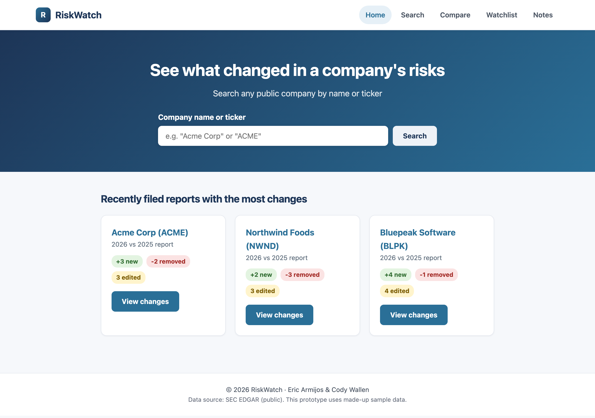
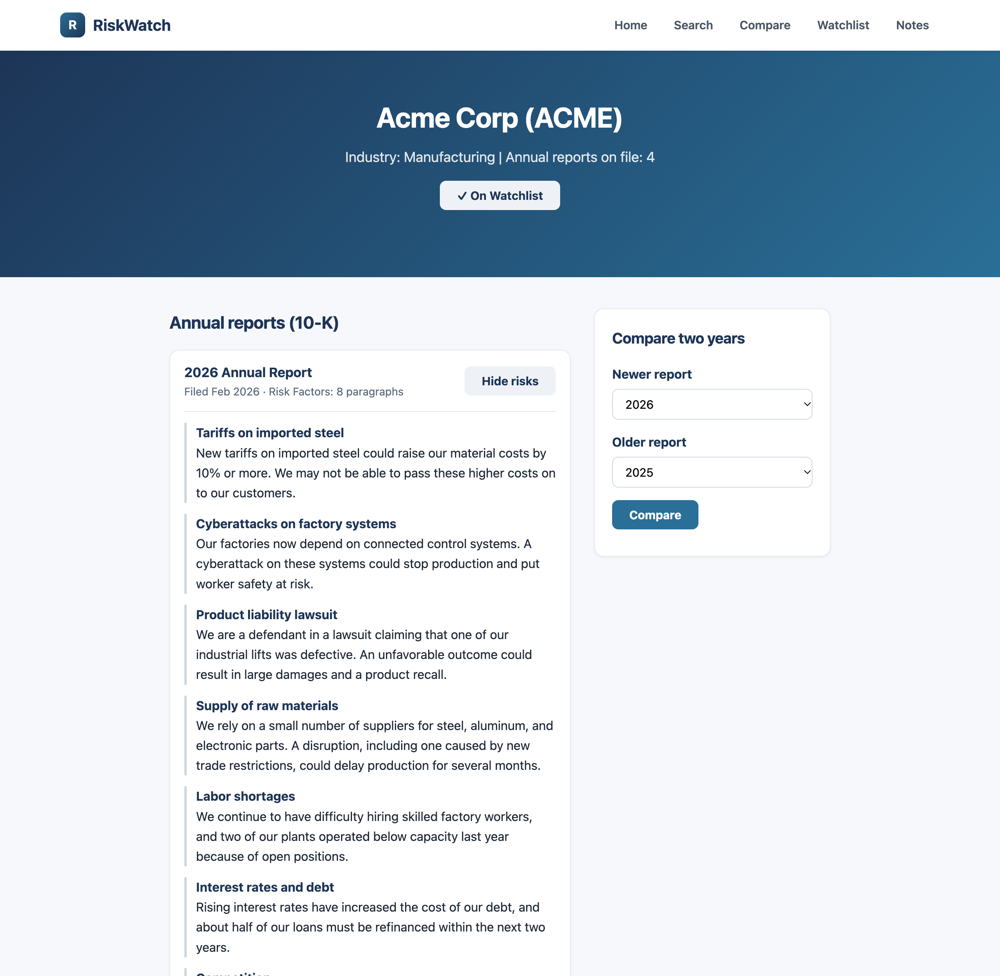
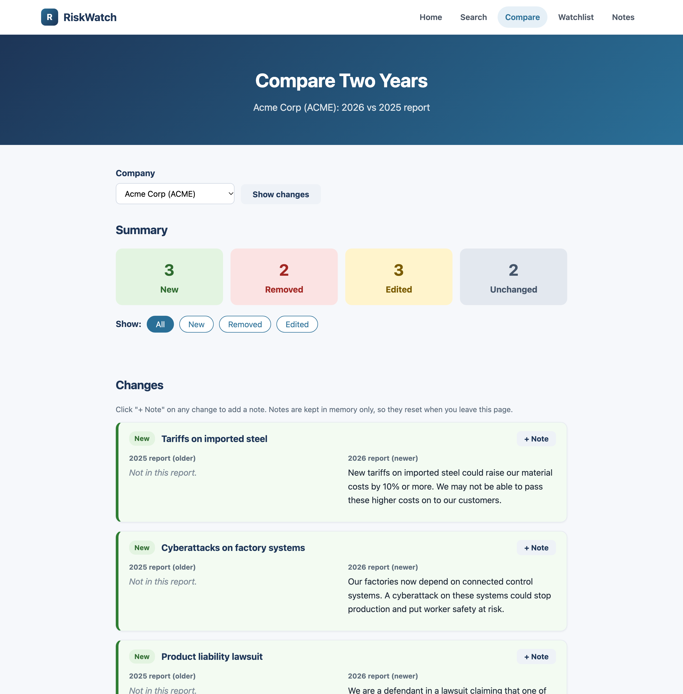
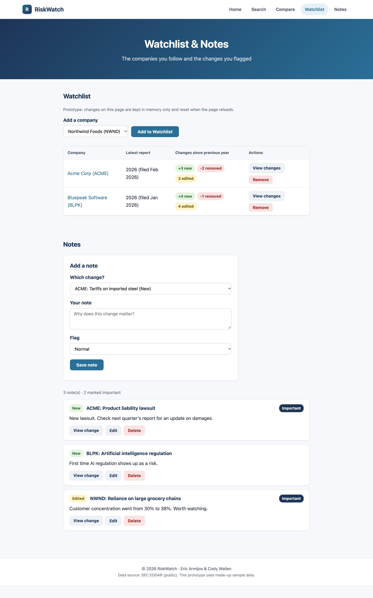

# RiskWatch

**See what changed in a company's risk disclosures, year over year.**

CSI 345 Web Software Development · Muhlenberg College · Fall 2026
Team Full-Stack Project · Milestone 2: Frontend Prototype

## Team Members

- Eric Armijos
- Cody Wallen

## About the Prototype

Every public company files an annual report (Form 10-K) with the SEC, and each one has a "Risk Factors" section listing what could hurt the business. Most of that section is copied from the year before, so the parts that actually change are easy to miss.

RiskWatch lets a user pick a company and see which risks were **added** (green), **removed** (red), or **reworded** (yellow) between two annual reports. This milestone is a frontend-only prototype: plain HTML, CSS, and JavaScript with made-up sample data. No frameworks or libraries are used.

## Pages and Features

| Page | What it does |
|---|---|
| **Home** (`index.html`) | Search form plus "recently filed reports" cards showing each company's new / removed / edited counts |
| **Search** (`search.html`) | Results filter live as you type, by company name or ticker. Also picks up a search sent from the Home page |
| **Company** (`company.html?ticker=ACME`) | Annual reports by year with a Read risks / Hide risks toggle, an Add to Watchlist button, and a form to choose two years to compare (with error messages for invalid choices) |
| **Compare** (`compare.html?ticker=ACME`) | Older and newer report side by side, color-coded, with summary counts, All / New / Removed / Edited filter buttons, and a "+ Note" form on every change |
| **Watchlist & Notes** (`watchlist.html`) | Watchlist table with Add and Remove. The Notes section lets you add, edit, and delete notes and flag them as Important |

A shared navigation bar (Home, Search, Compare, Watchlist, Notes) appears on every page, highlights the current page, and turns into a hamburger menu on screens narrower than 700px.

**Main user flow:** Home → search for a company → company page → compare two years → add a note / add to watchlist → Watchlist & Notes page.

## How to Run

**Live demo:** https://ericarmijos.github.io/RiskWatch/

To run it locally, no install or build step is needed:

1. Clone or download this repository.
2. Open the folder in VS Code and start **Live Server** on `index.html`, or just double-click `index.html` to open it in a browser.

## What Is Simulated with Dummy Data

All data lives in `data.js`:

- **Three fictional companies:** Acme Corp (ACME), Northwind Foods (NWND), and Bluepeak Software (BLPK). We made them up on purpose, because invented risk text attributed to a real company would be misleading.
- **Annual reports:** 3–4 years per company. Only the **2026 vs 2025** pair has risk paragraphs. Picking any other pair shows a "not available in this prototype" message.
- **Risk changes:** every paragraph is already labeled `new`, `removed`, `edited`, or `unchanged`. **There is no text comparison yet.** The compare page only displays these hard-coded labels.
- **Watchlist and notes:** start with sample entries. Adding, removing, editing, and deleting only change arrays in memory, so **everything resets when the page reloads or you go to another page.** For example, a note added on the Compare page will not show up on the Notes page yet. Saving data is the backend's job in a later milestone.

## What We Build Next

- **Express backend** with a REST API to serve companies, reports, and notes
- **Database** so the watchlist and notes are saved between visits and pages
- **Real SEC data** pulled from the public EDGAR database instead of `data.js`
- **The comparison engine:** code that splits two reports into paragraphs and works out which risks were added, removed, or reworded (written by us, without AI)
- **Login** so each user has their own watchlist and notes

## Screenshots

### Home page


### Company page


### Compare page


### Watchlist & Notes page


## Project Structure

```
index.html       Home page
search.html      Search results with live filtering
company.html     One company's reports, watchlist button, compare form
compare.html     Side-by-side changes, counts, filters, note form
watchlist.html   Watchlist table and Notes section (#notes)
style.css        One shared stylesheet for every page
data.js          All dummy data (companies, reports, risk changes, notes)
main.js          One shared script; each block checks its elements exist first
screenshots/     Images used in this README
```

## AI Usage

**Tool used:** Claude Code (Anthropic's Claude Opus 5.5), with AI tools allowed under the course policy.

**What it generated:** We gave it our project proposal, the Milestone 2 instructions, the lecture slides, and Eric's portfolio as a style reference. It then generated the page shells, `style.css`, `data.js` (including the fictional companies and risk text), and `main.js`, one step at a time. We told it to stay within what we have learned in class, plus three small extras: the `input` event, `URLSearchParams`, and `.find()`. It also did a visual polish pass on the CSS (white navbar, system font, rounded cards), took the screenshots in this README with headless Chrome, and drafted this README.

**What we changed:**
<!-- TODO (Eric/Cody): list what you changed, rewrote, or decided yourselves, e.g. layout tweaks, wording, colors, data -->
- _To be filled in by the team._

**How we tested:**
- Tested each step in VS Code Live Server before moving on: clicked every nav link, the hamburger menu, search, show/hide risks, the compare form and its error messages, filters, and add / edit / delete for notes and the watchlist.
- Checked the layout at phone width with Chrome DevTools device mode.
- Checked the Chrome DevTools Console for errors on every page.
<!-- TODO (Eric/Cody): adjust this list to match what you actually tested -->

We can explain every line of code and every design decision in this project.
