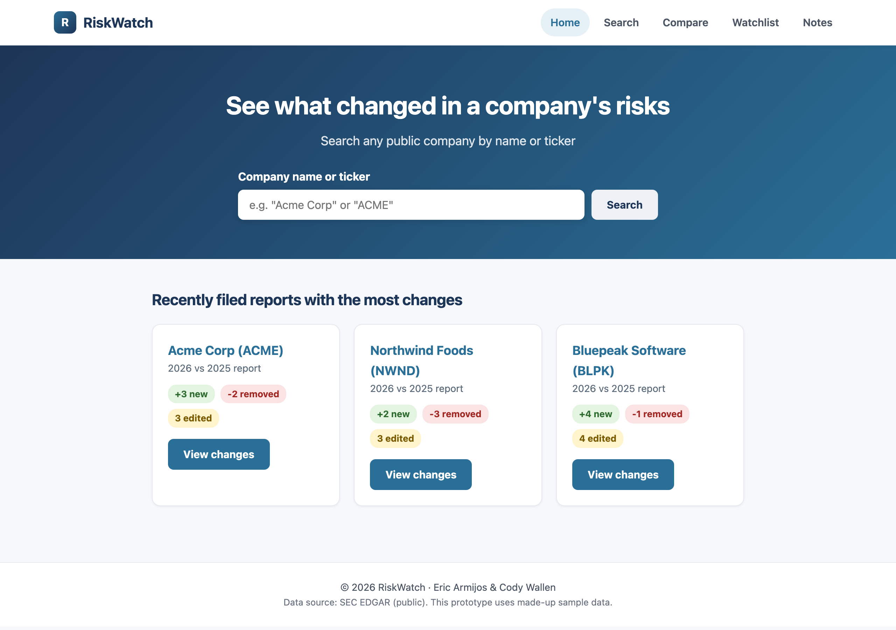
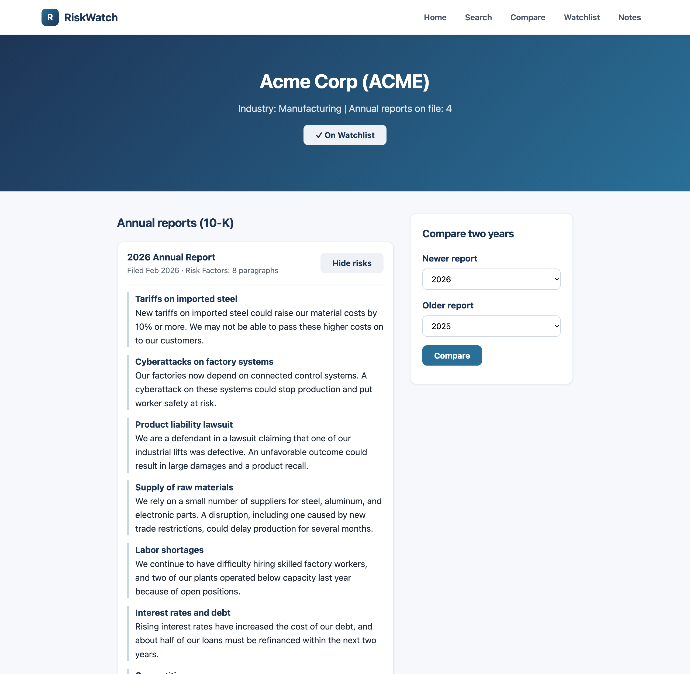
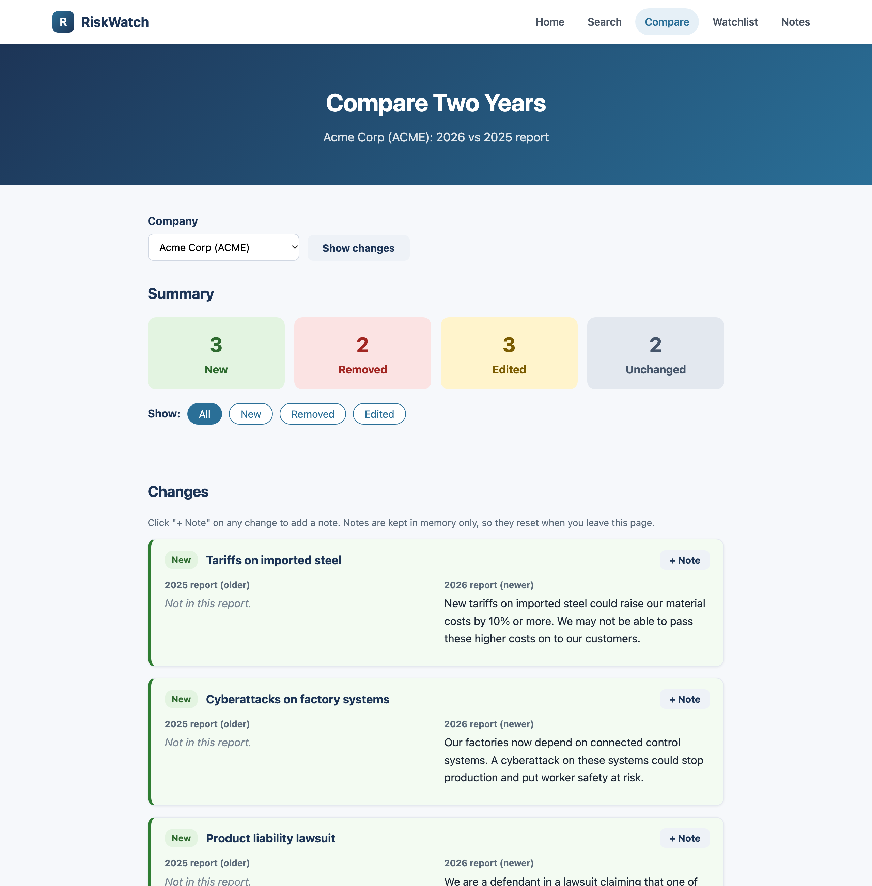
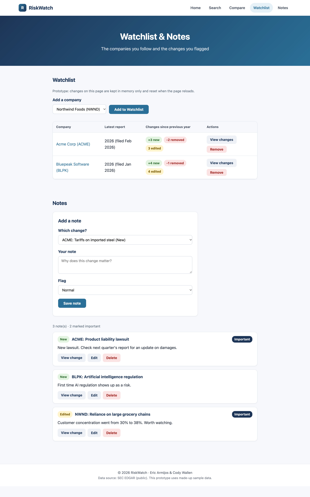

# RiskWatch

**See what changed in a company's risk disclosures, year over year.**

CSI 345 Web Software Development · Muhlenberg College · Fall 2026
Team Full-Stack Project · Milestone 3: Backend and Database Integration
Link to repository: ericarmijos.github.io/RiskWatch/

## Team Members

- Eric Armijos
- Cody Wallen
- Charley Madlock

## Current Project Status
We have created the databases for the companies and for the watchlist so that customers can choose which companies they want to watch. When they add a company to their watchlist, it will stay there so that they have it when they come back. We also have the dummy code for the three original companies that were on our website from the previous milestone. 

## Backend technologies used
We used Node.js and Express to help create the backend of our project. We also used SQlite and an API. We used the SQlite to make a database so that we could save information from the customers wishlist and notes that they made. We used the API in order to get the company information from the SEC so that the customer could look up any company that was in their system. 

## Database used
Our two databases are called companies.db and watchlist.db. They can be found on your local computer since we made them through vs code. We have title, ticker, cik, and industry in the company.db and title, ticker, industry, and added_at in the watchlist.db. 

## Main data model/resource
We are using SQlite within VS code. This is the one that we went over in class and since it is the one that we have the most knowledge about, we decided to use it.

## Current working backend features
The GET, POST, and DELETE functions all work inside of the databases. We were also able to create a database in our local computers. We also have routes, models, and a db Connect so that everything can work together from back end to the front end. the routes connect to the models and the db because the routes are the middleware in between the backend and frontend.  

## Which frontend feature is currently connected to the backend/database
The frontend feature that is currently connected to the backend/database is the watchlist button. You are able to click on it and it will save in your watchlist inside the database. The watchlist on the front end is clicked, which goes into the middleware, and then it goes to your database so that it is permanently saved in there. 

## Instructions for running the application
**Live demo:** https://ericarmijos.github.io/RiskWatch/

The code only works on a local computer because that is how we learned to do it in class, so you need to download the file before it can work. 

To run it locally, no install or build step is needed:

1. Clone or download this repository. 
2. Make sure to install node and express onto your computer.
3. When everything is installed you can type in node app.js and it will start the server on the computer.
4. Open the folder in VS Code and start **Live Server** on `index.html`, or just double-click `index.html` to open it in a browser.
5. Go to the search bar and type in a name of a company.
6. Click on the open company and you can decide to add it to your watchlist or not. 

# What your team plans to complete next
Next we plan on building the comparing area and having the reports from multiple years. we also will make the different risks work so that you can see it on the website. We will also work on the notes area so that customers can write things down that they want to remember or keep track of. We will also make sure that we get rid of all the dummy data and that everything works together like it should. 

## AI Usage

**Tool used:** Claude Code (Anthropic's Claude Opus 5.5), with AI tools allowed under the course policy.
We used Claude to help us connect the front end and the back end. We asked it for help on connecting the two since we do not have a lot of information on how to do that. It fixed the main.js so that we were able to add the companies to the watchlist. We also used it in order to help us make the website look like the dummy data because we were not able to figure out what we did wrong. We made the backend by ourselves and we tried to connect the two before using AI. When we could not figure it out, we decided to ask AI since we do not have a ton of information on it. We used it mainly for debugging and learning how to write specific code that we do not have.


CSI 345 Web Software Development · Muhlenberg College · Fall 2026
Team Full-Stack Project · Milestone 2: Frontend Prototype

## Team Members

- Eric Armijos
- Cody Wallen

## About the Prototype

Every public company files an annual report (Form 10-K) with the SEC, and each one has a "Risk Factors" section listing what could hurt the business. Most of that section is copied from the year before, so the parts that actually change are easy to miss.

RiskWatch lets a user pick a company and see which risks were **added** (green), **removed** (red), or **reworded** (yellow) between two annual reports. This milestone is a frontend-only prototype: plain HTML, CSS, and JavaScript with made-up sample data. No frameworks or libraries are used.

## Pages and Features

| Page | What it does |
|---|---|
| **Home** (`index.html`) | Search form plus "recently filed reports" cards showing each company's new / removed / edited counts |
| **Search** (`search.html`) | Results filter live as you type, by company name or ticker. Also picks up a search sent from the Home page |
| **Company** (`company.html?ticker=ACME`) | Annual reports by year with a Read risks / Hide risks toggle, an Add to Watchlist button, and a form to choose two years to compare (with error messages for invalid choices) |
| **Compare** (`compare.html?ticker=ACME`) | Older and newer report side by side, color-coded, with summary counts, All / New / Removed / Edited filter buttons, and a "+ Note" form on every change |
| **Watchlist & Notes** (`watchlist.html`) | Watchlist table with Add and Remove. The Notes section lets you add, edit, and delete notes and flag them as Important |

A shared navigation bar (Home, Search, Compare, Watchlist, Notes) appears on every page, highlights the current page, and turns into a hamburger menu on screens narrower than 700px.

**Main user flow:** Home → search for a company → company page → compare two years → add a note / add to watchlist → Watchlist & Notes page.

## How to Run

**Live demo:** https://ericarmijos.github.io/RiskWatch/

To run it locally, no install or build step is needed:

1. Clone or download this repository.
2. Open the folder in VS Code and start **Live Server** on `index.html`, or just double-click `index.html` to open it in a browser.

## What Is Simulated with Dummy Data

All data lives in `data.js`:

- **Three fictional companies:** Acme Corp (ACME), Northwind Foods (NWND), and Bluepeak Software (BLPK). We made them up on purpose, because invented risk text attributed to a real company would be misleading.
- **Annual reports:** 3–4 years per company. Only the **2026 vs 2025** pair has risk paragraphs. Picking any other pair shows a "not available in this prototype" message.
- **Risk changes:** every paragraph is already labeled `new`, `removed`, `edited`, or `unchanged`. **There is no text comparison yet.** The compare page only displays these hard-coded labels.
- **Watchlist and notes:** start with sample entries. Adding, removing, editing, and deleting only change arrays in memory, so **everything resets when the page reloads or you go to another page.** For example, a note added on the Compare page will not show up on the Notes page yet. Saving data is the backend's job in a later milestone.

## What We Build Next

- **Express backend** with a REST API to serve companies, reports, and notes
- **Database** so the watchlist and notes are saved between visits and pages
- **Real SEC data** pulled from the public EDGAR database instead of `data.js`
- **The comparison engine:** code that splits two reports into paragraphs and works out which risks were added, removed, or reworded (written by us, without AI)
- **Login** so each user has their own watchlist and notes

## Screenshots

### Home page


### Company page


### Compare page


### Watchlist & Notes page


## Project Structure

```
index.html       Home page
search.html      Search results with live filtering
company.html     One company's reports, watchlist button, compare form
compare.html     Side-by-side changes, counts, filters, note form
watchlist.html   Watchlist table and Notes section (#notes)
style.css        One shared stylesheet for every page
data.js          All dummy data (companies, reports, risk changes, notes)
main.js          One shared script; each block checks its elements exist first
screenshots/     Images used in this README
```

## AI Usage

**Tool used:** Claude Code (Anthropic's Claude Opus 5.5), with AI tools allowed under the course policy.

**What it generated:** We gave it our project proposal, the Milestone 2 instructions, the lecture slides, and Eric's portfolio as a style reference. It then generated the page shells, `style.css`, `data.js` (including the fictional companies and risk text), and `main.js`, one step at a time. We told it to stay within what we have learned in class, plus three small extras: the `input` event, `URLSearchParams`, and `.find()`. It also did a visual polish pass on the CSS (white navbar, system font, rounded cards), took the screenshots in this README with headless Chrome, and drafted this README.

**What we decided and directed:**
- The project idea, features, user flow, and wireframes all come from our Milestone 1 proposal.
- We wrote the rules the AI had to follow: use fictional companies instead of real ones, use only concepts from our lectures, build one shared `style.css` and `main.js`, and leave the text-comparison logic for us to write ourselves later.
- We had it build one step at a time and checked each step before approving the next one.
- After seeing the first version, we asked for a more modern design and approved the new navbar and card styles.

**How we tested:**
- Tested each step in VS Code Live Server before moving on: clicked every nav link, the hamburger menu, search, show/hide risks, the compare form and its error messages, filters, and add / edit / delete for notes and the watchlist.
- Checked the layout at phone width with Chrome DevTools device mode.
- Checked the Chrome DevTools Console for errors on every page.

We can explain every line of code and every design decision in this project.
